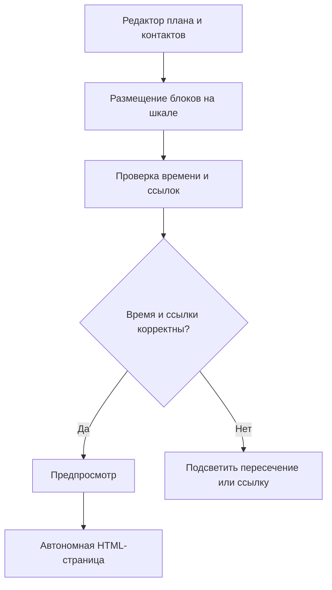

# 203 · Конструктор первого рабочего дня

Репозиторий `first-day-builder` · браузерное приложение

**Продукт и интерфейс.** Наставник выбирает дату, собирает план из встреч, самостоятельных задач и материалов. В редакторе можно менять порядок блоков, назначать контакты и добавлять ссылку. Новичок получает отдельную HTML-страницу с планом дня и может открыть её без доступа к редактору.

**Архитектура и данные.** TypeScript моделирует план, блоки с началом и длительностью, контакты и ссылки. Локальный валидатор находит пересечения и невалидные интервалы. Генератор HTML экранирует пользовательский текст и принимает ссылки HTTP/HTTPS. Черновик хранится в IndexedDB. Сервер и ML не нужны.

**Блок-схема основного сценария**

**Функциональные правила.** Хранить время блоков в минутах от начала выбранной даты. После сортировки проверять пересечения с учётом самой поздней границы предыдущих блоков. Смежные встречи допустимы. Неназначенные по времени материалы выводить отдельным разделом.

**Контракты реализации.** Модули `plan-editor`, `timeline-validation`, `plan-store` и `html-export`. Один объект `DayPlan` передаётся в предпросмотр и экспорт, ссылки нормализуются перед публикацией.

**Проверки граничных случаев.** Длинная встреча с двумя вложенными конфликтами. После исправления выгрузить страницу, открыть её отдельно и проверить, что HTML в подписи отображается текстом.

**Разработка и приёмка.** Сделать редактор и временную шкалу, затем проверку пересечений, предпросмотр и экспорт. Два пересекающихся блока должны подсветиться. После переноса встречи выгруженная страница открывается отдельно и показывает правильный порядок, ссылки и контакты.
